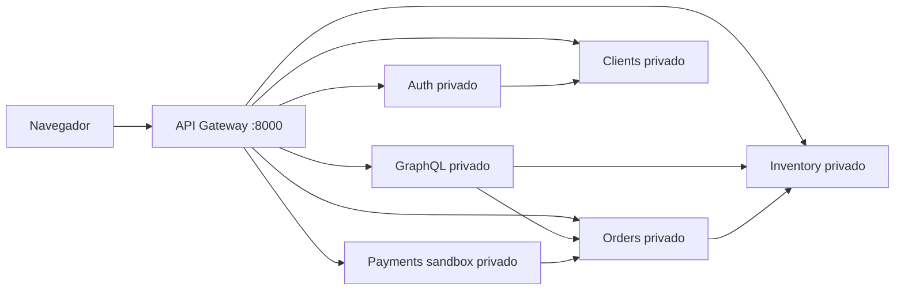
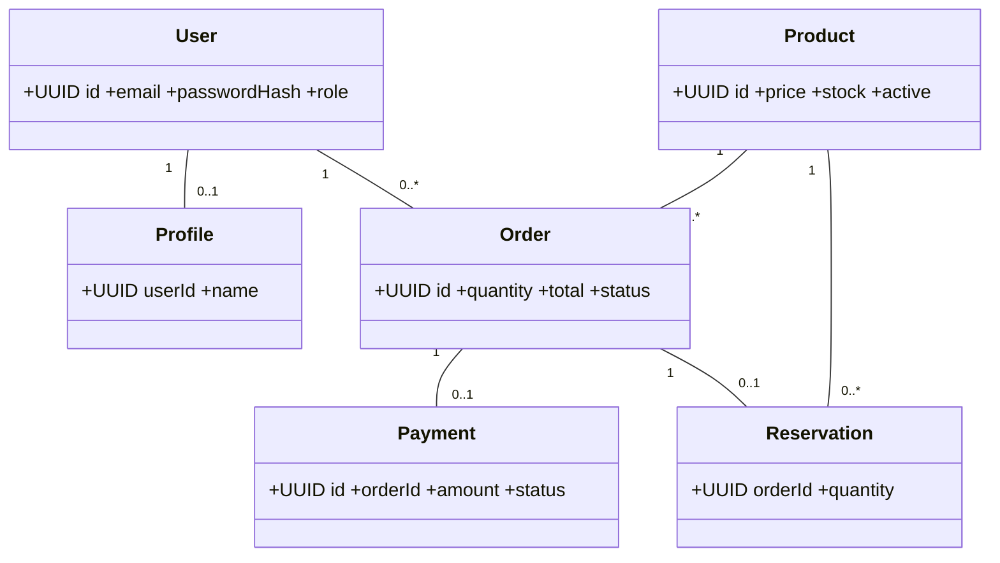
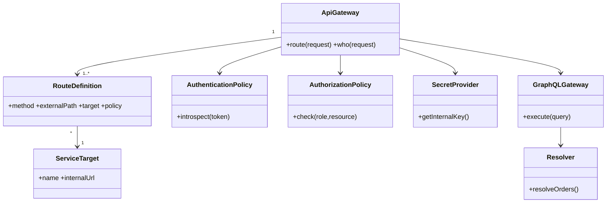

# Evaluación 2 — Backend seguro de Minecraft Web

**Rama de trabajo:** `evaluacion2-backend-seguro` (no modifica `main`).
**Referencia técnica:** ejemplos de FastAPI, autenticación, gateway y GraphQL del repositorio docente `evivanco/dwm20260203/Unidad 2`. Se reimplementaron las responsabilidades sin copiar usuarios ni secretos de ejemplo.

## Alcance y aclaración del profesor (8-11-2026)
Esta entrega evalúa principalmente el backend, sus contratos y los eventos que representaría el frontend. **No requiere la integración completa con la web**, que corresponde a la entrega final. Se añadió opcionalmente `tienda-segura.php` sin quitar el contenido ni el menú existente. No confundir una demostración opcional con una obligación académica.

**Caso asumido provisionalmente:** catálogo y pedidos de productos de Minecraft Web. Confirmar con el equipo el número exacto del caso de la lista de 40 antes de entregar. El sistema de pagos utiliza únicamente un simulador privado, no pagos bancarios reales.

## Requisitos
Docker Desktop y Docker Compose v2. Python 3.12 para las pruebas externas.

## Arranque reproducible
```bash
cd evaluacion2
cp .env.example .env
# Reemplazar INTERNAL_SERVICE_KEY con un valor aleatorio largo.
docker compose up --build -d
docker compose ps
curl http://127.0.0.1:8000/health
```
Windows PowerShell: `Copy-Item .env.example .env`.
El frontend PHP original queda en http://localhost:8081/index.php y la demostración opcional en http://localhost:8081/tienda-segura.php.

## Provisión de administrador
No se instala ningún usuario administrador por defecto. Provisione uno de forma explícita, después de levantar los servicios:
```bash
docker compose exec -e ADMIN_EMAIL=admin@example.test -e ADMIN_PASSWORD=CAMBIAR_POR_UNA_CLAVE_MUY_LARGA auth python -m services.provision_admin
```
Evitar poner contraseñas reales en el historial de la terminal. Para una demostración puede usar una credencial ficticia única; al publicar un entorno real, utilice un gestor de secretos.

## Detener y pruebas
```bash
python -m pip install -r tests/requirements.txt
python -m pytest tests -v
docker compose down
```
Los tests se deben ejecutar *con los contenedores levantados*. Para los tests de administrador, exportar `ADMIN_EMAIL` y `ADMIN_PASSWORD` iguales a los usados en la provisión. Ninguna ejecución ni resultado se afirma sin evidencia local. Los volúmenes conservan los datos; `docker compose down -v` los elimina.

## Arquitectura

Cada servicio tiene una base SQLite independiente en su propio volumen Docker. Los datos no se comparten mediante una base única. La red `private` no publica puertos de microservicios. El gateway propaga identidad verificada y no acepta rutas arbitrarias.

## Módulo 1: servicios y correspondencia con pantallas
| ID | Pantalla / evento | Ruta y verbo | Acceso | Datos |
|---|---|---|---|---|
| S01 | Productos / cargar | GET /api/v1/products | Anónimo | catálogo público |
| S02 | Productos / ver detalle | GET /api/v1/products/{id} | Anónimo | producto público |
| S03 | Administración / alta | POST /api/v1/products | Administrador | nombre, precio, stock |
| S04 | Administración / edición | PUT /api/v1/products/{id} | Administrador | producto validado |
| S05 | Administración / baja lógica | DELETE /api/v1/products/{id} | Administrador | desactiva |
| S06 | Registro / registrar | POST /api/v1/auth/register | Anónimo | correo, nombre, clave |
| S07 | Acceso / login | POST /api/v1/auth/login | Anónimo | correo y clave |
| S08 | Acceso / salir | POST /api/v1/auth/logout | Cliente | token |
| S09 | Cuenta / perfil | GET /api/v1/me | Cliente | perfil propio |
| S10 | Pedido / crear | POST /api/v1/orders | Cliente | product_id, quantity |
| S11 | Mis pedidos / listar | GET /api/v1/orders | Cliente | propios o todos si admin |
| S12 | Pedido / detalle | GET /api/v1/orders/{id} | Propietario o admin | detalle |
| S13 | Pedido / anular | POST /api/v1/orders/{id}/cancel | Propietario o admin | estado |
| S14 | Pedido / iniciar pago | POST /api/v1/payments/{id} | Propietario o admin | pago sandbox |
| S15 | Administración / confirmar sandbox | POST /api/v1/sandbox/confirm/{id} | Admin | pago de prueba |
| S16 | Mis pedidos / agregado | POST /api/v1/graphql | Cliente | orders + inventory |

Ejemplo JSON para S10: `{"product_id":"UUID_DE_PRODUCTO","quantity":1}`. El cliente no envía el precio ni el estado pagado. La respuesta contiene `id`, `total` calculado y `status=pending`.

## Módulo 2: modelo y cardinalidades

Reglas: un usuario puede tener varios pedidos; cada pedido tiene exactamente un producto en esta versión, con cantidad positiva. El pedido pendiente puede tener una reserva y como máximo un pago. Se mantiene historial al desactivar un producto. Los DTO no devuelven hash, salt ni secretos.

## Módulo 3: sistemas
| Sistema | Autoridad | Persistencia | Dependencia |
|---|---|---|---|
| inventory | catálogo, existencias, reservas | inventory.db | orders |
| orders | creación y estados de pedido | orders.db | inventory |
| clients | datos de perfil | clients.db | auth |
| payments | estado de pagos sandbox | payments.db | orders |
| auth | usuarios y sesiones | auth.db | clients |

Nota: por ser un prototipo académico, la coordinación de reservas entre servicios no es una transacción distribuida completa; evaluar reconciliación ante fallos concurrentes antes de producción.

## Módulo 4: stakeholders y permisos
| Rol | Catálogo GET | Productos POST/PUT/DELETE | Pedidos GET/POST | Confirmación sandbox |
|---|---|---|---|---|
| Visitante | Sí | No | No | No |
| Cliente | Sí | No | Solo propios | No |
| Administrador | Sí | Sí | Sí | Sí |
| Servicios internos | Por contrato | Por alcance del servicio | Por contrato | Por contrato |
Stakeholders sin permisos operativos: docente/evaluador, supervisores externos. Las autorizaciones se verifican en gateway y servicios; no se confía en ocultar controles.

## Módulo 5: clases del gateway (diseño)

La política actual está implementada con un mapa de rutas cerrado, no como clases runtime separadas. SecretProvider representa la lectura de variable de entorno, no un Vault externo.

## Módulo 6: rutas y secretos
Todas las rutas externas aparecen en la matriz S01–S16 y apuntan a rutas internas equivalentes del servicio dueño. Los microservicios privados requieren `x-internal-key`; la identidad `x-user-id/x-user-role` es inyectada por el gateway y nunca se toma del navegador.

Inventario: `INTERNAL_SERVICE_KEY`, secreto de servicio compartido en esta demostración; responsable: operador; ubicación: archivo `.env` local no versionado; revocación: reemplazar la clave y reiniciar servicios. **Limitación:** requiere credenciales por servicio y gestor de secretos antes de uso real. TLS debe suministrarlo un proxy inverso en un despliegue público; esta demo solo publica el gateway en localhost.

## Módulo 7: datos personales
Correo y nombre son personales; los pedidos pertenecen al titular; precios y descripciones de catálogo son públicos. Se almacenan hash scrypt con sal aleatoria, nunca contraseñas en claro. Sesiones opacas: 30 minutos de duración, hash SHA-256 del token en el almacén; logout elimina sesión. No almacenar claves de pagos ni tarjetas porque solo existe sandbox local. Se deben definir políticas específicas de retención de perfiles y auditoría al pasar a producción.

## Módulo 8: GraphQL
El gateway GraphQL privado combina `orders` e `inventory` en `myOrders` mediante un lote de catálogo.
```graphql
query {
  myOrders {
    id
    quantity
    total
    status
    product { name price }
  }
}
```
Solo Query, una operación, máximo 1.800 caracteres, profundidad 5, nodos 40. Es obligatorio iniciar sesión. Los pedidos se filtran por propietario en orders, no en el navegador.

## Módulo 9: ADR-001, analítica y gRPC
**Contexto:** catálogo escolar y pedidos con tráfico bajo, sin evidencia de streaming o análisis masivo.
**Alternativas:** REST interno, gRPC unary/streaming, mensajería STOMP y servicio analítico.
**Decisión provisional:** REST interno entre servicios; STOMP y gRPC no implementados, porque no existe un requisito de streaming acreditado. No se requiere analítica separada para una consulta de pocos pedidos.
**Consecuencias:** menos complejidad, pero deben medirse latencia p95, throughput, errores, CPU y memoria con carga reproducible antes de justificar formalmente no aplicar gRPC/analítica.

## Módulo 10: evidencia pendiente y limitaciones
Implementación inicial del backend, frontend opcional, despliegue y pruebas automatizadas incluidas. **Sin evidencia de pruebas ejecutadas ni despliegue verificado.** Faltan mediciones de carga y completar datos del caso elegido. Para pagos reales se necesitaría proveedor de pago, webhook autenticado, reconciliación y garantías transaccionales; el simulador no debe presentarse como integración bancaria.

## Material a presentar al profesor
1. Capturas de `docker compose ps` y `/health`.
2. Pruebas GET público, POST login, GET pedidos 401 sin token, POST producto 403 con cliente, consulta GraphQL y evidencia del sandbox.
3. Diagramas UML en formato editable (se pueden trasladar de Mermaid a draw.io).
4. Tabla caso/pantalla/servicio/prueba/resultado con resultados reales.

## Material complementario listo para el informe
- [Contratos, pantallas, requisitos y trazabilidad](docs/contracts-and-traceability.md)
- [Stakeholders, seguridad, rutas y datos sensibles](docs/security-and-routes.md)
- [ADR REST, gRPC y analítica](docs/adr-001-rest.md)
- [Plantilla de resultados reales](docs/evidence-template.md)
- [Diagramas editables](diagrams/)
- [Pruebas adicionales de negocio](tests/test_business_flows.py)
- [Prueba de carga reproducible](tests/load_test.py)
- [GitHub Actions](../.github/workflows/evaluacion2-backend.yml)

El proyecto está en la rama **evaluacion-2**. Los diagramas son archivos Mermaid editables. El caso exacto entre los 40 debe confirmarse y los resultados deben medirse; esto no reemplaza evidencia de ejecución.
